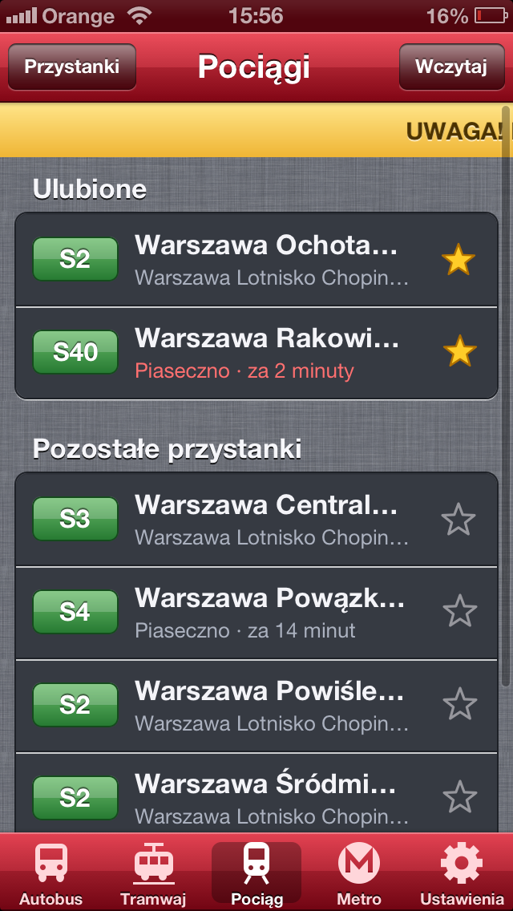
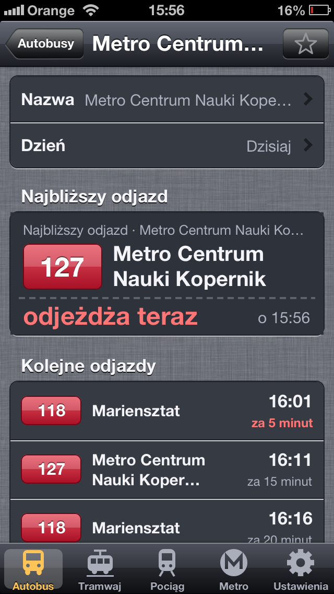
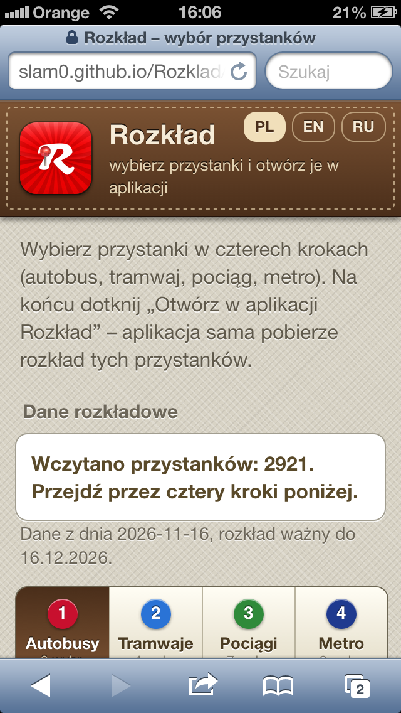

# Rozkład

Aplikacja Rozkład pozwala załadować warszawski rozkład jazdy autobusów, tramwajów, pociągów SKM i metra (beta) na telefon z iOS 6.x.x.
(Możliwe, że w przyszłości zostaną dodane inne miasta.)

Aplikacja działa offline\*.

\* Plik z rozkładem należy zrobić w [kreatorze](https://slam0.github.io/Rozklad/kreator/).

  
  
  

## Funkcje

- Nadanie własnej nazwy konkretnemu przystankowi
- Zmiana języka (polski, angielski, rosyjski)
- Zmiana motywów (Grafit, Czerwony, Skóra i Klasyczny)
- Przypomnienia o odjazdach
- oraz inne funkcje

## Instalacja

Zalecam instalację przez plik `.ipa` (**wymagany AppSync Unified!**), natomiast plik `.deb` również jest dostępny.

Repozytorium do Cydii zostanie niedługo upublicznione.

## Dane

Rozkłady udostępnia [mkuran.pl](https://mkuran.pl).

## Autor

nazar0vsky (lub slam0)

Aplikacja zrobiona w 95% przez Claude AI.
